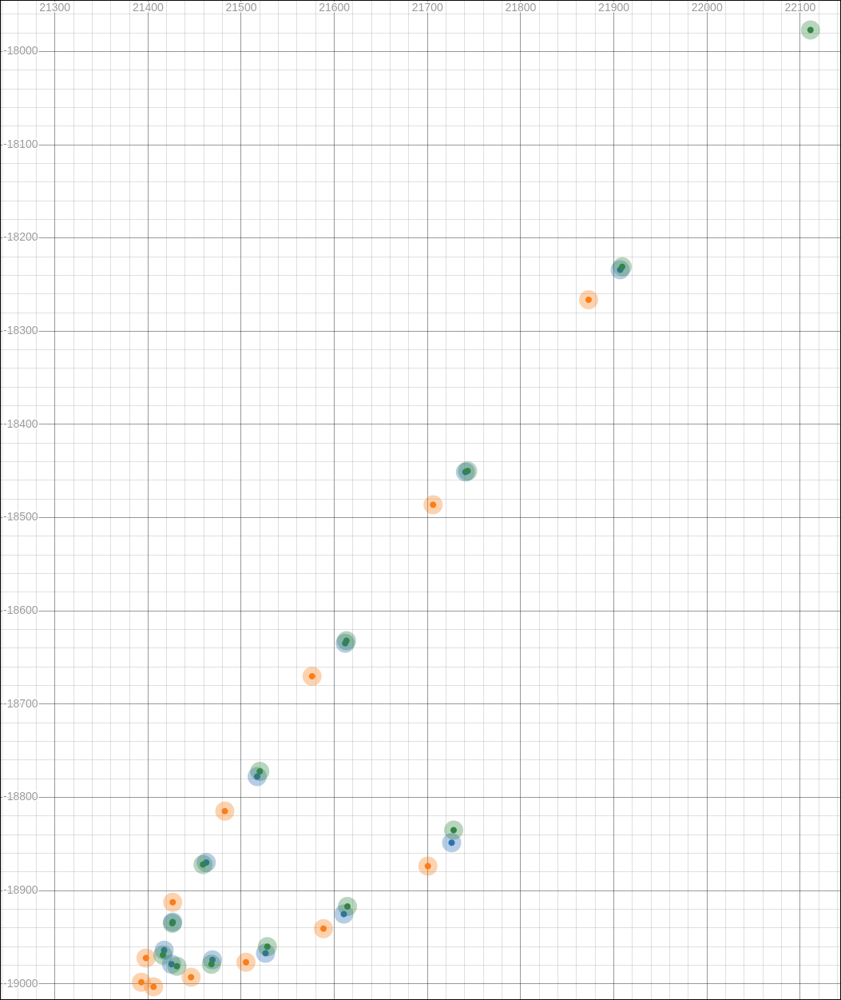

# The Saturn Collection [](https://github.com/shreddism/TheSaturnCollection/releases)

A set of filters which is planned to grow to include the current multifilter for all different types of users, as well as more niche optional plugins.

Formatting may be non-final.

### Most Recent Update

1.1.0 - Releases page will have update notes.

# Important

Recent developments have rendered a lot of what used to be in this README as well as prediction itself mostly obsolete. The README will see more changes as things solidify.

#### Stock PTK-470 Prediction Comparison (green = tablet report, yellow = temporal resampler, blue = the saturn collection)
The top right report is the start of the sample.



# High Report Rate Noise Compensation

This filter acts like any other smoothing filter, except it applies to acceleration, velocity, and then position, and it works off of assuming that a reported position will never be more than the set amount of noise away from the true position. This leads to it not acting like a smoothing filter at all, and it ends up targeting noise a lot more than actual movement.

# Area Rounding
A sort of "Circular Area"-lite. You can make its effects as extreme or as subtle as you want with configuration. Most things are explained in the tooltips. The modifiers for input and output being different from each other allows you to set your own curve.

# Custom Reset Absolute Mode
You may need to apply and save multiple times for settings to apply properly.

Multiple options are available to move your area. These are pretty much self explanatory and many things can be done with a combination of these.

## Reset Modes

#### Set Tablet Area Center To Position
This effectively puts the cursor to the center of the display setting's area.

#### Drag Tablet Area / Fake Relative Mode
These internally do the same thing, but dragging holds the reset while fake relative mode just triggers it.

#### Set Both Centers To Posiiton
This sets the center of the display area's setting. which changes where setting the tablet area's center to position will put the cursor. This also changes behavior if using an extra transform like Circular Area.

#### Reset To Stock Settings
Self-explanatory. Might need multiple applies/saves to function.

# Filter Ordering
- Go to File > Save settings as...
- Save the file and remember its location (documents folder).
- Open your file browser and open the file. If you've never seen/edited a .json file before, install/use Visual Studio Code.
- Pre-transform and post-transform filters are ordered among themselves by the settings file. For example. the multifilter and Temporal Resampler are pre-transform (as most plugins are), so if you want to use these in Akatsuki's relax mode, you'll have to do this:
- Seen below is an example of the contents of a Filters section.
```
"Filters": [
      {
        "Path": "Plugin2.Filter",
        "Settings": [
          ...
        ],
        "Enable": true
      },
      {
        "Path": "Plugin1.Filter",
        "Settings": [
          ...
        ],
        "Enable": true
      }
    ],
```
- There should be a comma after every filter but the last, so you would flip these around and fix the commas.
```
"Filters": [
      {
        "Path": "Plugin1.Filter",
        "Settings": [
          ...
        ],
        "Enable": true
      },
      {
        "Path": "Plugin2.Filter",
        "Settings": [
          ...
        ],
        "Enable": true
      }
    ],
```
- Save the file with Ctrl+S, go to OTD, File > Load settings... > Load the file. Console output should mirror the settings file. Example:
```
[Wacom PTK-470:Info]	Pen Bindings: Adaptive Binding: Button 1, Adaptive Binding: Button 2, Adaptive Binding: Button 3
[Wacom PTK-470:Info]	Filter Settings Circular Approximate Equal Area Inverse
[Wacom PTK-470:Info]	Filter Settings Plugin 1: (setting1: 0)
[Wacom PTK-470:Info]	Filter Settings Plugin 2: (setting2: 0)
[Settings:Info]	Driver is enabled.
```
- Note how I just included a random Circular Area option. This does NOT apply first, as it's post-transform, so it must apply after the output mode's transformation of tablet coordinates to screen coordinates, which pre-transform filters always go before. Keep this in mind, and if you want to be sure, look for the position in a plugin's source code.
